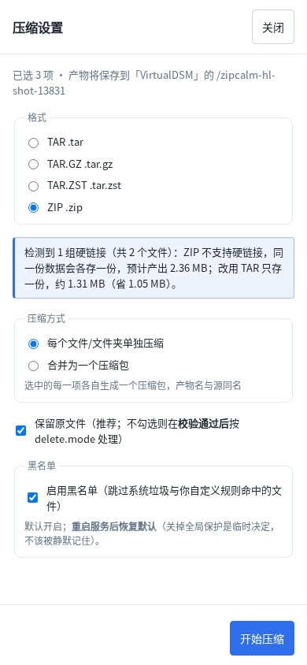

# ZipCalm 压压惊

> 一个跑在 NAS 上的 Node.js 网页服务端：浏览文件目录、选择文件/文件夹压缩（多算法多格式）、按类型去重（硬链接）、带性能监控看板。
>
> 当前状态：**M0~M8 已完成 + 硬链接去重已上线 + 硬链接预检提示**（版本 `1.0.0`），19 套验收全绿。手机端 PWA（M9）待做。

## 界面预览

**硬链接预检提示** —— 选 ZIP 压含硬链接的目录时，直接算出「各存一份会多花多少」，并建议改 TAR：


切到 TAR 后提示自动变成正向说明（同一份数据只存一份、省多少空间），不会出现「选了 TAR 还提示 ZIP 翻倍」这类自相矛盾：


**窄视口（390×844）** —— 提示条换行不溢出，主操作按钮仍在视口内：



**加密压缩包解压** —— 打开加密包时自动识别并弹出密码框；密码错、缺密码、包损坏三种情况分别给不同提示，不会一律报「文件损坏」：


## 快速开始

### 方式一：npm 安装（任意机器，无需源码）

```bash
npx zipcalm                 # 直接跑，默认端口 3010、数据在 ~/.zipcalm
npm i -g zipcalm            # 或全局安装，之后直接 zipcalm

zipcalm --port 8080         # 换端口
zipcalm --data-dir ~/mydata # 换数据目录（任务状态/日志/回收站都在这里）
zipcalm --help              # 全部参数
```

- **数据默认放在 `~/.zipcalm`**（不在包目录里，升级/重装不丢数据）：含 `config.json`、`fs-root`（可浏览的默认存储根）、`trash`（回收站）、`logs`、`tasks.json`
- **首次运行会自动生成随机管理员密码并打印一次**（用户名 `admin`）；也可以用 `ZIPCALM_PASSWORD=xxx zipcalm` 自己指定，或编辑 `~/.zipcalm/config.json`
- **没有系统 `unrar` / `7z` 也能用**：RAR 走 `node-unrar-js`、7z 走 `js7z-tools`（都是 npm 依赖里的 WASM 引擎，随包安装）
- 需要 Node **≥ 22.15**

### 方式二：从源码（NAS 部署 / 开发）

**访问**（局域网，需先启动服务）：

```
http://<本机IP>:3010
```

**启停**（服务不会开机自启，重启 NAS 后需手动启动）：

```bash
bash scripts/start.sh start     # 启动
bash scripts/start.sh status    # 状态
bash scripts/start.sh stop      # 停止
bash scripts/start.sh restart   # 重启（已在跑时改配置用这个）
```

**首次登录**：默认账号 `admin` / `zipcalm`。

> ⚠️ **上线前请改密码**（默认密码等于把删除权限交给所有知道它的人）：
> ```bash
> node scripts/hash-password.js '你的新密码'   # 输出 scrypt 哈希
> # 把哈希写进 storage/config.json 的 auth.passwordHash，然后 restart
> ```

**安全边界**：

- 默认监听 `0.0.0.0:3010`（局域网可访问）。**要做公网访问必须先加 HTTPS 反代** —— 当前是明文 HTTP，直接暴露等于公开密码。
- `storage/` 存着凭据与运行数据（已 gitignore），**不要整个目录打包分享**。
- 删除原文件默认走 `log-only`（只记账不算），手动删除进回收站 `storage/trash/` 可找回。
- **硬链接去重是信息合并**（不可逆）：请先用 dry-run 看清"能省多少"，确认弹窗里的警告再执行。

## 名字的由来

| 维度 | 分析 |
|---|---|
| 双关 | **压** = 压缩文件，**压惊** = 安抚焦虑。NAS 空间不足本身就是一种「存储焦虑」，压完就「惊」了。 |
| 功能暗示 | 一听就知道跟「压缩」有关，不需要解释。 |

## 文档索引

| 文档 | 内容 |
|---|---|
| [docs/00-需求演进与设计决策.md](https://github.com/EIGHTfs/ZipCalm/blob/main/docs/00-需求演进与设计决策.md) | 需求演进轨迹：每个阶段的诉求 → 采纳的方案 → 为什么，以及贯穿全程的三条原则 |
| [docs/01-需求与总体架构.md](https://github.com/EIGHTfs/ZipCalm/blob/main/docs/01-需求与总体架构.md) | 原始需求、决定架构的三个问题、必须想清楚的决策 |
| [docs/02-压缩格式与库选型.md](https://github.com/EIGHTfs/ZipCalm/blob/main/docs/02-压缩格式与库选型.md) | zip/tar/tar.gz/tar.zst 的库选型、库 vs 二进制、zstd 方案（Node 内置） |
| [docs/03-插件化架构与格式契约.md](https://github.com/EIGHTfs/ZipCalm/blob/main/docs/03-插件化架构与格式契约.md) | 每个格式一个格式包、插件契约、总入口职责边界 |
| [docs/04-压缩模式与黑名单.md](https://github.com/EIGHTfs/ZipCalm/blob/main/docs/04-压缩模式与黑名单.md) | 单独压缩/打包为一个、三层黑名单、智能跳过 |
| [docs/05-任务系统与进度推送.md](https://github.com/EIGHTfs/ZipCalm/blob/main/docs/05-任务系统与进度推送.md) | 后台任务、进度连续性、SSE 推送、状态落盘 |
| [docs/06-删除原文件与磁盘预检.md](https://github.com/EIGHTfs/ZipCalm/blob/main/docs/06-删除原文件与磁盘预检.md) | 先压→校验→再删、回收站、两倍空间预检 |
| [docs/07-性能监控看板.md](https://github.com/EIGHTfs/ZipCalm/blob/main/docs/07-性能监控看板.md) | 指标采集分层、采集频率、六个卡片 |
| [docs/08-前端布局设计.md](https://github.com/EIGHTfs/ZipCalm/blob/main/docs/08-前端布局设计.md) | 网盘式骨架、鼠标优先、触屏最小兼容、右键菜单 |
| [docs/09-API契约与APK铺路.md](https://github.com/EIGHTfs/ZipCalm/blob/main/docs/09-API契约与APK铺路.md) | API 规范、双认证、UUID、SSE、Range、错误码 |
| [docs/10-开源项目参考.md](https://github.com/EIGHTfs/ZipCalm/blob/main/docs/10-开源项目参考.md) | 9 个已克隆项目的可抄代码清单（文件:行号）+ 路径安全实现对比 |
| [docs/11-开发里程碑与验收标准.md](https://github.com/EIGHTfs/ZipCalm/blob/main/docs/11-开发里程碑与验收标准.md) | M0~M9 分步计划与逐条验收标准 |
| [docs/12-项目目录结构.md](https://github.com/EIGHTfs/ZipCalm/blob/main/docs/12-项目目录结构.md) | server/web/shared/docs/scripts/test 全目录设计 |
| [docs/M0/](https://github.com/EIGHTfs/ZipCalm/blob/main/docs/M0/README.md) | **M0 契约冻结（v1）**：API 规范 / 插件契约 / 数据模型 / 不变量清单 + 验收结论与拍板记录 |
| [docs/13-工期估算与模型分工.md](https://github.com/EIGHTfs/ZipCalm/blob/main/docs/13-工期估算与模型分工.md) | 工期估算（基于实测吞吐外推）+ 各阶段模型分工方案（主力 / 辅助） |
| [docs/14-工程执行约定.md](https://github.com/EIGHTfs/ZipCalm/blob/main/docs/14-工程执行约定.md) | 执行层约定：每任务收尾固定做「审计 + 顺手优化 / 全套验收 / 停服务 / 汇报」、契约优先、写入范围、常用命令、踩过的坑 |
| [docs/15-硬链接去重.md](https://github.com/EIGHTfs/ZipCalm/blob/main/docs/15-硬链接去重.md) | 硬链接去重：需求 + 评审结论（抽样哈希不可判定重复 / 复用路径白名单 / 替换顺序须崩溃可恢复）+ 实现规格 |
| [docs/16-侧栏与根目录设计.md](https://github.com/EIGHTfs/ZipCalm/blob/main/docs/16-侧栏与根目录设计.md) | 侧栏「根」的设计：按系统自动选模式（群晖列共享文件夹 / 其他列卷），含多根配置、`fs/volumes` 端点与验收标准 |
| [docs/17-设计与实现差异记录.md](https://github.com/EIGHTfs/ZipCalm/blob/main/docs/17-设计与实现差异记录.md) | 设计文档与代码实现的偏离登记：保留「设计意图 vs 实际实现」对照，便于回溯 |
| [docs/19-压缩密码与能力插件设计.md](https://github.com/EIGHTfs/ZipCalm/blob/main/docs/19-压缩密码与能力插件设计.md) | 压缩密码的架构设计：能力插件三层契约、架构图、PW-1~4 安全约束、P1~P4 分阶段 |
| [docs/18-待办功能排期.md](https://github.com/EIGHTfs/ZipCalm/blob/main/docs/18-待办功能排期.md) | 功能排期与完成状态（7z/rar 待做；压缩包密码、硬链接预检提示已完成） |
| [docs/research/mt-apk-reverse-01-侦察与保护.md](https://github.com/EIGHTfs/ZipCalm/blob/main/docs/research/mt-apk-reverse-01-侦察与保护.md) | MT 管理器 APK 逆向（v2.26.10，共 4 册）：① 侦察与保护 ② 压缩实现 ③ SMB 与远程路径 ④ 借鉴与结论。**插件路线不可行的双重证据**在第 3、4 册 |
| [docs/audit/M5-审查与修复.md](https://github.com/EIGHTfs/ZipCalm/blob/main/docs/audit/M5-审查与修复.md) | 删除链路的对抗式审查结论：10 个真问题 + 7 处契约漂移 + 9 项修复方案 + 复验门禁 |

## 当前进展

| 里程碑 | 状态 | 交付 |
|---|---|---|
| M0 契约冻结 | ✅ | API 规范 / 插件契约 / 数据模型 / 不变量清单（`docs/M0/`） |
| M1 骨架跑通 | ✅ | 目录浏览、登录鉴权、路径白名单与越界防护 |
| M2 单格式压缩 | ✅ | zip 压缩与解压（zip-slip 防护、绝不覆盖、假数据逐文件 hash 往返校验） |
| M3 任务系统 | ✅ | 任务落盘与崩溃恢复、串行队列、SSE 实时进度、任务记录保留策略与手动清理 |
| M4 多格式插件化 | ✅ | tar / tar.gz / tar.zst（Node 内置 zstd）+「加目录即注册」+ 启动自检 Node ≥ 22.15 |
| M5 删除原文件 | ✅ | 删除流程（校验通过 → 二次确认 → 进回收站 → 日志）；`waiting_confirm` 可取消 + 超时；`deleting` 前抢执行槽位；崩溃后启动对账 |
| M6 黑名单与预检 | ✅ | 三层黑名单（全局**仅 3 条系统垃圾** / 用户自定义 / 任务级临时）+ 命中项跳过且不参与删除 + 磁盘剩余 < 待压 × 2 拒绝启动 |
| M7 性能看板 | ✅ | 6 张卡片（CPU / 内存 / 事件循环延迟 / 磁盘 IO / 活跃任务 / 最近完成），2 秒轮询；采集**零新依赖**（Node 内置 + `/proc`），开销双口径实测 < 0.1% CPU |
| M8 打磨与触屏 | ✅ | 右键菜单三套（文件/目录/空白）+ 键盘全驱动（Ctrl+A / Delete / F2 / 方向键 / Enter）+ 目录树拖拽移动 + **触屏**：网格视图、长按=右键、可点区 ≥40px / 行高 ≥44px、无「悬停才显示」 |
| **硬链接去重** | ✅ | 按白名单类型扫重复大文件 → 三层判定（`size` 分组 → 头尾+中间抽样**快筛** → **全量 SHA-256 终判**）→ 建硬链接省空间；dry-run 默认 + 强制确认弹窗 + 操作日志；替换走 `rename→link→unlink`，**崩溃时数据始终一份可达** |
| **硬链接预检提示** | ✅ | 压前用 `dev + ino` 归组识别硬链接（零额外 syscall）：所选格式不保留硬链接且多存占比 ≥10% 时提示「预计产出 / 换 TAR 省多少」，tar 家族给正向说明；纯信息条不阻断，空间与删除判定不变 |
| **RAR 解压（只读）** | ✅ | 新增 RAR 格式包：**只解压、不生成**（闭源商业算法，未授权不能压缩）；走用户已装的 `unrar`（优先）或 `7z`，缺二进制显式报错并给修复建议；rar4/rar5、多卷、加密（缺密码 / 密码错 / 包损坏三态分开）全支持；条目安全与 zip、tar 共用同一套 zip-slip 判定 |
| **7z（双向）** | ✅ | 新增 7z 格式包：**可压缩可解压**，走三级回退链 —— 系统 `7z/7za`（本机 p7zip 16.02）→ WASM 引擎（`js7z-tools`，内置 7-Zip 25.01 多线程）→ 不可用（置灰 + 说明）。支持 `-mx0..9` 压缩级别、原生密码（三态错误分离）、条目安全与 zip/tar/rar 同一套；卖点是 **Windows 双击即开**（压缩率实测只比 tar.zst 优约 1%） |
| M9 | ⏳ | **手机端 PWA**（可添加到主屏幕；曾评估"做 MT 管理器插件"，两轮调研——文档调研 + APK 逆向——均确认**不可行**：v3 插件只有 editor/translation/regex 三类扩展点，且 `PluginContext` 无用户文件访问能力。详见 `docs/research/mt-apk-reverse-04-借鉴点与结论.md`） |

**已实现能力**（截至 `0.12.1`）：

- 浏览器中浏览目录、多选、压缩（zip / tar / tar.gz / tar.zst / **7z**）、解压（**六个格式**：zip / tar / tar.gz / tar.zst / 7z / **rar（仅解压）**，含 `.tar.gz` 这类复合扩展名识别）
- 后台任务：状态落盘、崩溃后自动标记中断并保留半成品、串行执行、SSE 推送进度、断线重连先拉快照再续序号
- **删除原文件**：校验通过才删；二次确认同时比对文件数与字节数；进回收站（可找回）而非真删；删除日志可追溯；中断后启动对账（文件安全在回收站）
- **黑名单与磁盘预检**：三层规则（全局 3 条系统垃圾：`Thumbs.db` / `.DS_Store` / `@eaDir` / 用户自定义 / 任务级临时），命中项**不进压缩包、也不参与删除**；选目录时实时提示「X 个文件已跳过」并标出命中规则与所在层；磁盘剩余不足「待压量 × 2」时任务直接拒绝启动
- **性能看板**：CPU / 内存 / 事件循环延迟（带「正常 / 有压力 / 卡顿」语义分档，不只给数字）/ 磁盘 IO / 活跃任务 / 最近完成；2 秒轮询，离开页面即停、切后台暂停
- **桌面与触屏两套交互**：桌面有右键菜单（文件/目录/空白三套）、键盘全驱动、拖拽移动；触屏有网格视图、长按=右键，可点区 ≥40px、行高 ≥44px，**无「悬停才显示」的操作**（触屏底部操作栏按需求隐藏，代码保留待重新设计）
- **多存储位置**：侧栏按系统自动选模式 —— 群晖列**共享文件夹**（C 模式）、其他列**卷/挂载点**（B 模式），每项带容量进度条（`>90%` 变红）；点选即切换根，面包屑显示 `[共享名] / 路径`，压缩前告知产物落点
- **文件名搜索**：只搜当前存储位置内（有界遍历：深度 6 / 结果 500 / 3 秒超时，跳过符号链接与黑名单目录），结果显示在**主区列表**（含完整路径与大小时间），点目录进入、点文件定位
- **硬链接去重**：按扩展名白名单扫描重复文件，**抽样只做快筛、终判必须全量哈希**（防止同系列视频因头尾相同被误合并）；执行前服务端重新复核内容；`rename→link→unlink` 三步替换，任何一步崩溃数据都有一份可达；dry-run 默认、强制确认、每条操作落日志
- **7z（可压缩可解压，双引擎）**：引擎按三级回退——① 系统 `7z`/`7za`（零新增依赖；`ZC_7Z_BIN` 指定路径时**独占**，配错就如实报不可用而不是偷偷换一个）→ ② **WASM 引擎 `js7z-tools`（7-Zip 25.01，多线程，依赖内置：没装 p7zip 的机器也能用 7z）** → ③ 都没有则格式置灰并说明（`ZC_7Z_DISABLE_WASM=1` 可临时关掉 WASM）。`probe()` 能直接报出当前用哪个引擎及其版本。
  - **WASM 的完成语义**：MT 版 `callMain` 是异步的，完成信号只来自 `onExit` 回调。实现上每次操作跑在**独立子进程**里，严格等 `onExit` 之后才读产物（验收里有一条"解压返回后立刻 readdir，文件必须齐全"）。
  - **WASM 与网络盘**：WASM 经 Emscripten NODEFS 落盘时会做 chmod/chown，**CIFS 挂载会拒绝**（报 `errno=63 / EPERM`）。所以 WASM 模式下**可写路径先落本地盘临时目录**，再由 Node **流式**搬到目标（`fs.copyFile` 在 CIFS 上同样 EPERM，不能用）；原生引擎仍直写零拷贝。这条有专门的「真实服务 + WASM」用例守着：起服务带假 `ZC_7Z_BIN` → 走 HTTP 建压缩/解压任务 → 连跑 3 轮。
  - **CPU 纪律（重要，全格式统一）**：7z 默认按核数开线程、WASM 固定 3 线程，不限流会把整机 CPU 打满（实测触发过系统级 CPU 过载保护）。**所有外部/WASM 引擎统一走 `server/core/engineRunner.js` 一个执行入口**，自动获得：绑核「总核数 − 1」+ `nice -n 10` + **跨格式全局串行**（任何时刻只允许一个引擎进程；以前 7z 与 RAR 各有一把锁，两者能同时跑把 CPU 打满）。核数可用 `ZC_ENGINE_CPU_CORES` 覆盖（统一入口，不设即默认「总核数 − 1」）。
    - **限核按平台分层、逐级降级**：① 应用层线程数（仅 7z 原生有 `-mmt`，产物 md5 与线程数无关）② OS 绑核（Linux `taskset`；Windows 走 PowerShell 设 `ProcessorAffinity`，**未在真机验证**；**macOS 没有可用绑核手段 → 如实跳过**）③ 优先级（`nice` / Windows `Idle`）。`taskset` 缺失时只降优先级并在日志里明说，**绝不"看起来在限其实没限"**。
  - **大输入上限**：WASM 是 32 位地址空间（4 GB），单任务输入超过 **2 GB** 在写盘前就拒绝，并建议改用 tar.zst（原生引擎无此限制）。压缩级别 `-mx0..9` 真实透传（同一份文本 -mx0=115 KB / -mx9=265 B，验收有断言）。密码为 7z 原生能力，缺密码 / 密码错 / 包损坏三态分开。**卖点是兼容性不是体积**：实测压缩率只比 tar.zst 优约 1%，但 Windows 无需装软件即可双击打开
- **RAR 解压（只读，不生成，双引擎回退）**：RAR 压缩算法是闭源商业算法，本项目**只做解压**（`create()` 直接拒绝并说明原因，RAR 不提供压缩）。解压引擎按三级回退：① 系统 `unrar`（`ZC_UNRAR_BIN` 可指定，**设了就独占**）→ ② 纯 JS/WASM 引擎 **`node-unrar-js`**（内置 unrar 6.1.7，系统没有 unrar 时兜底）→ ③ 都没有则格式置灰并说明。`ZC_UNRAR_ENGINE=native|js` 可强制指定引擎（排障/对比用）。`probe()` 会报出 `{kind, version, filenameSafe}`。
  - **为什么需要这一层**：老版 unrar 对 **RAR5 的中文文件名**有 bug——同一份样本 `unrar 5.70` 解出 `s7/????????????????.txt`（落盘字节 `efbfbe…`，UTF-8 被当 UTF-16），而 `unrar 7.23` 解出 `s7/中文文件名.txt`（`e4b8ad…`）。`filenameSafe` 以 **7.0** 为阈值（保守：5.70 实测坏、7.23 实测好），低于它界面会提示「建议升级到 7.x」。
  - **js 引擎的实测边界（重要）**：`node-unrar-js@2.0.2` 能解 rar4/rar5、多卷、加密包（缺密码/错密码三态都对），**但对同一份 RAR5 中文名仍然乱码**（内置的 unrar 6.1.7 也有该 bug），且**损坏包不报错**（静默只解出部分文件）。所以：**有原生 unrar 时一律优先原生**（它更严格、能报损坏），js 只在"系统完全没有 unrar"时兜底——用它换来的是"能解"，不是"文件名正确"。
  - 支持 rar4 / rar5、多卷（给 part1 自动续卷）、加密包（缺密码 / 密码错 / 包损坏三种错误分开，不把「损坏」说成「密码错」）。为防归档内恶意路径，先解到**目标目录旁边的中转目录**，再经与 zip/tar 同一套条目判定（zip-slip、绝对路径、符号链接、不覆盖同名）搬进目标目录；进度按文件级上报（外部程序输出格式随版本变，百分比不可靠）。**绝不把 rar/unrar 二进制打进仓库**
- **乱码文件名自动还原**（PUA 转义）：老版 unrar / node-unrar-js 解 RAR5 中文名时，会把 UTF-8 字节**逐个**写成「U+FFFE 标记 + 私有区 U+E0XX（= 原字节 0xXX）」，显示成 `￾￾￾…`。这是**无损转义**不是信息丢失：去掉标记、把每个 U+E0xx 还原成字节再按 UTF-8 解码即得原名（`s7/中文文件名.txt`）。落地两处：**解压时自动还原**（在共享 `planTargets` 阶段、**还原后的名字上**做 zip-slip 判定，撞名则保留原名并记日志）与 **`POST /fs/repair-names` 修复已解压目录**（`dryRun` 默认 true，报告含候选/已改名/撞名/不可还原四类计数，绝不覆盖；另有 CLI `scripts/repair-names.mjs`）。判定**宁严勿松**：必须同时满足「含 U+FFFE 标记」+「解出是合法 UTF-8」+「往返一致」，正常文件名（哪怕合法含私有区字符）一律不动；带 `?` 的有损名救不回来，只列清单不猜编码。
  - **前提**：RAR 引擎必须在 `en_US.UTF-8` 下运行——默认 locale 与 **C.UTF-8** 都会输出有损 `?`（实测陷阱），只有 `en_US.UTF-8` / `zh_CN.UTF-8` 才给出可逆的 PUA 转义。
  - **实测过的库**（结论：不需要换库）：`node-unrar-js 2.0.2`、`js7z-tools(7-Zip 25.01)`、`unrar 5.70` 三者产出的转义字节**完全一致**且都能还原；`unrar-async` / `libarchive-wasm` / `7z-wasm` / `sevenzip-wasm` 因 API 形态与稳定性问题未采用（详见 docs/17 D-13）。
- **硬链接预检提示**（压前告知，不改任何空间判定）：遍历源时用 `lstat` 已有的 `dev + ino` 顺带归组（**同 `dev` 且同 `ino`** 才算，跨分区相同 `ino` 不算），预检返回「组数 / 组内文件数 / 逻辑大小 / 当前格式估算产出」；当所选格式**不保留硬链接**（zip）且"多存"占比 **≥ 10%** 时，压缩抽屉里提示「会各存一份、预计产出 X、换 TAR 只存一份约 Y（省 Z）」；换到 tar 家族则改为正向说明「会保留硬链接」。提示是**信息条不阻断**：用户可直接忽略继续压缩，预检/删除/空间不变量一律不变
- 安全不变量：路径白名单（`..` / 绝对路径 / 盘符 / NUL / 符号链接一律拒绝）、绝不覆盖同名产物、删除前复核集合与文件状态（有变化就跳过）
- 能力自探测：格式可用性**真探测**（zstd 走「Node 内置 → 系统命令」回退链，都不可用则该格式置灰并说明原因）
- **压缩包密码**（压缩与解压全链路已通）：能力以插件形式追加 —— 格式插件声明 `capabilities`，能力插件在 `server/plugins/capabilities/<id>/` 自注册，算法在 `methods/` 下可继续追加；当前支持 AES-256（强，但 Linux `unzip` / Windows 资源管理器解不开）与 ZipCrypto（兼容好、强度弱），前端按各自兼容性给出提示。加密包**压完必须用同一密码自测**，不通过即任务失败且不删原文件；明文密码不落日志、不落 `tasks.json`、不进 API 响应。解压侧：加密包自动识别（preflight 返回 `encrypted` 标志），AES-256 与 ZipCrypto 统一走 7z 解包（解到中转目录后仍过 zip-slip 白名单链才交付）；错误三态区分——缺密码 `MISSING_PASSWORD`、密码错误 `BAD_PASSWORD`、包损坏 `ARCHIVE_CORRUPTED`，绝不把密码错当「文件损坏」；缺 7z 时明确报「无法解压 AES 加密包」不静默降级

**一键验收**：`bash scripts/test-all.sh` 跑十九套（M1 不变量 / M2 往返 / M3 任务 / 崩溃恢复 / 边界探测 / 记录清理 / M4 多格式 / M6 黑名单 / M7 指标 / M8 文件写操作 / 多存储位置 / 多根隔离 / 硬链接扫描 / 硬链接执行 / 硬链接预检 / RAR 解压 / 7z / 引擎执行入口 / 构建门禁），当前全绿。

## 版本记录

版式：**里程碑完成升 minor（`0.x.0`）**，**修复与优化升 patch（`0.x.y`）**；`package.json` 与 `shared/app-version.js` 必须同值。

| 版本 | 里程碑 | 内容 |
|---|---|---|
| **1.0.0** | **npm 首发** | 可 `npx zipcalm` / `npm i -g zipcalm` 运行：新增 CLI（`bin/zipcalm.js`，只做参数→环境变量翻译）、`files` 白名单（只带 `bin/ server/ shared/ web/dist/ README LICENSE`，不含 docs）、首次运行自动生成随机口令配置；数据默认落 `~/.zipcalm`（含 fs-root/trash/logs/tasks.json），**从 git 仓库启动的行为一字未变**（数据仍在 `<项目根>/storage`）。README 里 29 处相对文档/图片链接改为绝对地址（npm 上才不 404） |
| 0.14.0 | 乱码名还原 | 解压时自动还原 PUA 转义的乱码文件名（共享阶段，zip/tar/7z/rar 通用）；新增 `POST /fs/repair-names` 与 CLI 修复已解压目录（dryRun 默认、绝不覆盖、四类计数）；RAR 引擎强制 `en_US.UTF-8`（默认 locale / C.UTF-8 会输出有损 `?`）；实测六款 RAR 解包库，结论是不换库、只做解码 |
| 0.13.0 | RAR 双引擎 | RAR 解压引擎改为三级回退（系统 `unrar` → `node-unrar-js@2.0.2` 纯 JS 兜底 → 置灰），新增 `ZC_UNRAR_ENGINE=native\|js` 与 `probe().filenameSafe`。**实测澄清了根因**：RAR5 中文名乱码是 unrar 版本 bug（5.70 坏 / 7.23 好），而 js 引擎内置的 6.1.7 **同样坏** → 换引擎修不了文件名，因此**有原生 unrar 时仍优先原生**（它还能正确报损坏包，js 会静默部分解出）。版本判 minor：新增引擎与依赖、影响部署面（没装 unrar 的机器从"不可用"变"可用"） |
| 0.12.1 | 7z 双引擎 | 接入回退② **WASM 引擎 `js7z-tools@2.5.0`（7-Zip 25.01）**：没装 p7zip 的机器也能压缩/解压 7z，产物与原生引擎**双向兼容**（同输入同尺寸、互解互验通过）。实现要点：每次操作独立子进程、严格等 `onExit`（MT 异步语义）再读产物；`ZC_7Z_DISABLE_WASM=1` 可关；单任务输入 >2 GB 提前拒绝并建议 tar.zst；CPU 默认绑「总核数 − 1」+ `nice` + 全局串行（这是本机 CPU 过载 503 事故的直接修复）。版本判 patch：对外仍是"7z 双向"，变的是引擎覆盖范围 |
| 0.12.0 | 7z（双向） | 新增 7z 格式包（`server/plugins/formats/sevenzip/`）：可压缩可解压；三级引擎回退（系统 7z/7za → WASM `js7z-tools`（本版未接入，0.12.1 补齐）→ 不可用）；`-mx0..9` 级别透传；原生密码三态分离；条目安全复用共享判定；压缩用"条目名走 argv 分批"（本机 p7zip 16.02 是 `Utf16=off` 构建，读 UTF-8 listfile 的中文名会失败） |
| 0.11.0 | RAR 解压（只读） | 新增 RAR 格式包（`server/plugins/formats/rar/`）：**只解压不生成**（闭源商业算法，`create()`/`estimate()` 显式拒绝）；解压走外部 `unrar`（优先）/`7z`（兜底），二进制缺失时置灰并给安装建议；rar4/rar5、多卷、加密包（`MISSING_PASSWORD` / `BAD_PASSWORD` / `ARCHIVE_CORRUPTED` 三态分离）；外部程序先解到中转目录，再经共享条目判定（zip-slip / 绝对路径 / 符号链接 / 不覆盖）搬入目标目录；进度按文件级降级上报 |
| 0.10.1 | 硬链接预检提示 | 预检按 `dev + ino` 归组统计硬链接（跨分区同 `ino` 不误判、黑名单跳过项不计入、嵌套选择不重复计数）；所选格式不保留硬链接且多存占比 ≥10% 时在压缩抽屉提示「预计产出 / 换 TAR 只存一份省多少」，tar 家族给正向说明；纯提示不阻断、不改空间判定与删除逻辑 |
| 0.10.0 | 能力插件 + 压缩密码 | 新增「能力插件」扩展点：格式插件用 `capabilities` 声明能力、能力插件按目录自注册、加密算法可继续追加；落地压缩包密码（AES-256 / ZipCrypto），含压完同密码自测、明文三通道脱敏（API / `tasks.json` / 日志）、删除前复核密码可解；解压侧支持加密包（AES-256 与 ZipCrypto 走 7z 解包 + 白名单搬移，缺密码 / 密码错 / 包损坏三态区分） |
| 0.9.0 | 硬链接去重 | 按白名单类型扫描重复大文件并建硬链接省空间：三层判定（size → 抽样快筛 → **全量 SHA-256 终判**）、执行前复核内容、`rename→link→unlink` 崩溃安全替换、dry-run 默认 + 强制确认 + 操作日志 |
| 0.8.0 | M8 | 打磨与触屏：右键菜单三套 / 键盘全驱动 / 拖拽移动；触屏网格视图 + 长按 + 底部操作栏，可点区 ≥40px、无悬停依赖；窄视口实测抓出并修掉 3 个布局 bug |
| 0.7.0 | M7 | 性能监控看板：6 张卡片、2 秒轮询（离开即停 / 切后台暂停）、事件循环延迟带语义分档；采集**零新依赖**（Node 内置 + `/proc`），开销双口径实测 < 0.1% CPU |
| 0.6.0 | M6 | 三层黑名单（全局 15 条已压缩格式 / 用户自定义 / 任务级临时）：命中项**不进包也不参与删除**、跳过数实时提示、磁盘剩余 < 待压 × 2 拒绝启动 |
| 0.5.0 | M5 | 删除原文件：校验通过才删、二次确认比对 files+bytes、进回收站可找回、删除日志可追溯、中断后启动对账；`waiting_confirm` 可取消 + 超时（超时绝不等于确认）且不阻塞队列 |
| 0.4.0 | M4 | tar / tar.gz / tar.zst（zstd 走 Node 内置 `node:zlib`）；「加目录即注册」；启动自检 Node ≥ 22.15 |
| 0.3.0 | M3 | 任务落盘与崩溃恢复、串行队列、SSE 进度推送、任务记录保留策略与手动清理 |
| 0.2.0 | M2 | zip 压缩与解压（zip-slip 防护、绝不覆盖、假数据逐文件 hash 往返校验） |
| 0.1.0 | M0 ~ M1 | 契约冻结（API 规范 / 插件契约 / 数据模型 / 不变量清单）；骨架跑通（目录浏览、登录鉴权、路径白名单） |

> 每次提交前扫一眼本节与「当前进展」：**版本号升了吗？功能描述还跟得上代码吗？**

## 核心设计结论速览

1. **架构先定，库后选**：先回答「压缩同步还是异步」「产物落盘还是下载即弃」「单用户还是多用户」，再谈选型。
2. **库为主、全零依赖**：zip 用 archiver、tar 系列用 node-tar、zstd 走 Node ≥ 22.15 内置的 `node:zlib` —— 全部无原生编译，也不依赖用户额外安装压缩工具。
3. **插件化**：每个格式一个格式包（ext/create/list/test/available/estimate），格式包只负责「怎么压」，调度/删除/预检归总入口。
4. **两种压缩模式**：单独压缩（每个文件夹一个包）/ 打包为一个，做成互斥单选。
5. **后台任务 + 事件驱动进度**：任务状态落盘、SSE 推送、前端断线不影响任务，重连拉快照。
6. **删除原文件五步走**：压缩完成 → 校验 → 标记 → 待确认 → 进回收站，任何一步失败都不删。
7. **磁盘预检**：剩余空间 ≥ 待压文件 × 2；单独压缩模式按单文件夹滚动检查。
8. **看板只留 6 个指标**：CPU、内存、事件循环延迟、磁盘 IO、活跃任务、最近完成。
9. **前端借网盘骨架，压缩提到操作第一位**；网页端鼠标优先，触屏只做「长按=右键」最小兼容。
10. **API 从第一天为 APK 铺路**：/api/v1 版本化、任务 UUID、SSE、双认证、Range、机器可读错误码。

## 技术选型原则

**优先成熟的库，不为「少依赖」而自研轮子。**

- 前端：Vue 3（SFC）+ vue-router + pinia + axios + dayjs + pretty-bytes；图标 **lucide-vue-next**、看板图表 **uplot**；构建 Vite + @vitejs/plugin-vue
- 后端：Fastify；压缩 archiver（zip）/ node-tar（tar、tar.gz、tar.zst）；监控 systeminformation + pidusage
- 系统级：无（zstd 由 **Node ≥ 22.15 内置的 `node:zlib`** 提供；系统 `zstd` 命令仅作回退项）
- 不引入：7z / rar（v1 范围外）、数据库（用 JSON/JSONL 落盘）、p-queue（v1 强制串行）、UI 组件库 / Tailwind

**库收口策略（换库改动量最小化）**：第三方库只允许在**唯一入口** import，由 `npm run check:drift` 门禁钉死（已挂到 `build` 前，违规即构建失败）：

| 库 | 唯一入口 |
|---|---|
| `lucide-vue-next` | `web/src/components/common/Icon.vue` |
| `uplot` | `web/src/components/metrics/TrendChart.vue` |
| `axios` | `web/src/api/client.js` |
| `dayjs` / `pretty-bytes` | `web/src/utils/format.js` |
| 压缩库（archiver / node-tar） | 各自的格式包 `server/plugins/formats/<id>/` |

**框架级依赖（Vue / vue-router / pinia / Fastify）不做收口** —— 换框架等于重写，包一层适配只会增加间接层而无收益。
门禁扫描器为正则实现（剥离注释后匹配 `import` / `export-from` / 动态 `import()` / `require`），已知边界：不支持极端多行 import 与 TS 装饰器；需要更强保证时再评估引入 AST 解析器。

> 本项目**不追求零依赖**。取舍是「部署可靠 + 开发效率优先」：所有依赖均为纯 JS 或 Node 内置（zstd 走 `node:zlib`），无原生编译，NAS 上无需构建工具链。
> 运行时要求：**Node ≥ 22.15**（zstd 内置 API 自 v22.15.0 起提供；`fs.statfs` 自 v18.15 起）。
> 目录与框架约定见 [docs/12-项目目录结构.md](https://github.com/EIGHTfs/ZipCalm/blob/main/docs/12-项目目录结构.md) 第三节。

## 设计来源

本项目的设计文档体系由需求演进逐步沉淀而成，需求与决策的来龙去脉见 [docs/00-需求演进与设计决策.md](https://github.com/EIGHTfs/ZipCalm/blob/main/docs/00-需求演进与设计决策.md)。

## 参考项目（第三方代码快照）

`参考项目/` 下是 10 个第三方开源项目的本地代码（9 个 git 克隆 + 1 个从 npm tarball 解压），用于精读可抄代码（见 [docs/10](https://github.com/EIGHTfs/ZipCalm/blob/main/docs/10-开源项目参考.md)）：

- 它们是**别人的代码**，不属于本项目产物，建议将来建仓时写进 `.gitignore`；
- 文档中的「文件:行号」绑定各仓库当时的 commit（commit 清单见 docs/10 第〇节），上游更新后行号会漂移；
- 其中一个项目（wfmanager）的路径防护实测存在缺陷，docs/10 已注明**只抄 UI 不抄安全逻辑**。

## 开发环境约束（依赖安装）

本工作区挂载在 NFS 上且带 `noexec`（`/tmp` 同样是 noexec），`node_modules` 里的原生二进制（esbuild 等）在工作区内无法执行；**直接在项目根执行 `npm install` 也会失败**——npm 10 的 reify 阶段会先删掉项目根的 `node_modules` 软链（日志：`npm warn reify Removing non-directory`），再在 noexec 盘建真实目录，随后 esbuild postinstall 报 `EACCES`。

因此依赖装在**可执行目录**（脚本自探测），项目根只保留一个指向它的软链：

```bash
bash scripts/setup-dev-deps.sh                                     # 幂等：未指定则自动探测可执行目录
ZIPCALM_BUILD_DIR=/some/exec/path bash scripts/setup-dev-deps.sh   # 显式指定（优先级最高）
```

- 依赖目录的确定顺序（`scripts/setup-dev-deps.sh` 的 `detect_build_dir`）：
  1. 环境变量 `ZIPCALM_BUILD_DIR`——先校验「可写 + 可执行」，不合格直接报错退出（不会默默换路径）；
  2. 自探测候选：项目根同级 `<父目录>/.zipcalm-build` → 从项目根**向上逐层**的 `<上层>/zipcalm-build` → `$TMPDIR/zipcalm-build`、`$HOME/.cache/zipcalm-build`（临时目录仅作兜底，可能被系统清理，重跑本脚本即可恢复）。
- **探测方式是「真写一个脚本并执行」**（`probe_exec_dir`）：noexec 挂载会被直接挡掉，所以不需要预先知道某个盘是不是 NFS、是不是 noexec；**脚本里没有任何机器专属的硬编码路径**。
- 软链：项目根 `node_modules` → `<依赖目录>/node_modules`；`package-lock.json` 落在依赖目录，不入库。
- 日常在项目根执行：`npm run dev`（开发服务，端口 5180）、`npm run build`（产物 `web/dist`）、`npm run preview`；后端服务用 `bash scripts/start.sh {start|stop|restart|status}`。
- **不要在项目根直接执行 `npm install` / `npm ci`**：会删掉软链并把依赖重新装到 noexec 盘。
- 源码始终留在工作区（`shared/`、`web/`、`server/`、`scripts/`、`package.json`）；依赖目录只是构建缓存，可随时重装。
- 忽略规则：`.gitignore` 忽略 `node_modules`（不带斜杠，同时匹配真实目录与软链）、`web/dist/`、`ZipCalm.pid`（运行时 PID 文件）、`storage/`（运行态数据与凭据配置）。

## 鸣谢

本项目由 AI 协作完成，特别鸣谢：

| 模型 | 承担 |
|---|---|
| **DeepSeek-V4.1-Flash** | 主开发（M1~M8 全部代码）+ 会话编排与独立验收 |
| **GLM-5.3-Flash** | M5「删除原文件」的独立审计与修复（7 批次）+ M6 / M8 若干攻坚 |
| **DeepSeek-V4-Flash** | 早期骨架与部分调试 |

**这套协作里真正起作用的不是模型强弱，是两条纪律**：

1. **契约先行** —— M0 把 API、数据模型、不变量冻成可测条款。实现方不用猜，验收方有据可依；条款有歧义就改契约，不在代码里各自解释。
2. **独立验收** —— 不采信"我跑绿了"。所有套件由验收方独立复跑，关键路径亲手复现（`kill -9`、造假数据、拆硬链接），连"某次断言本身不严谨"也当场纠正。

代价是每个功能收尾要多花 20~30 分钟；换来的是 15 套验收 + 50 余个单测案例能长期全绿，以及**每次返工都有据可查**。

## 许可证

[MIT](LICENSE) © 2026 EIGHTfs

一句话：你可以自由使用、修改、分发、商用，只需保留版权声明与许可证文本。

